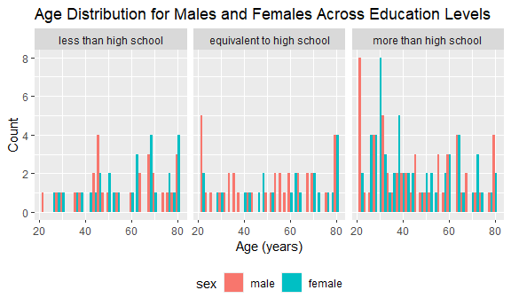
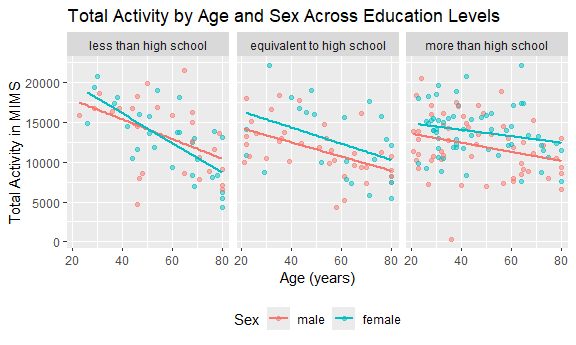

P8105_hw3
================
cmh2275
2026-10-16

# Problem 1

# Problem 2

## Import and Tidy

``` r
nhanes1_df = read_csv(file = "./nhanes_covar.csv", skip = 4, na = c("NA", "", "."))|>
    janitor::clean_names()|>
mutate(sex = factor(sex, 
                    levels = c("1","2"), 
                    labels = c("male", "female")), 
       education = factor(education, 
                          levels = c("1", "2", "3"), 
                          labels = c("less than high school", "equivalent to high school","more than high school"))
       )|>
  filter(age>=21)
```

    ## Rows: 250 Columns: 5
    ## ── Column specification ────────────────────────────────────────────────────────
    ## Delimiter: ","
    ## dbl (5): SEQN, sex, age, BMI, education
    ## 
    ## ℹ Use `spec()` to retrieve the full column specification for this data.
    ## ℹ Specify the column types or set `show_col_types = FALSE` to quiet this message.

``` r
nhanes2_df = read_csv(file = "./nhanes_accel.csv", na = c("NA", "", "."))|>
  janitor::clean_names()
```

    ## Rows: 250 Columns: 1441
    ## ── Column specification ────────────────────────────────────────────────────────
    ## Delimiter: ","
    ## dbl (1441): SEQN, min1, min2, min3, min4, min5, min6, min7, min8, min9, min1...
    ## 
    ## ℹ Use `spec()` to retrieve the full column specification for this data.
    ## ℹ Specify the column types or set `show_col_types = FALSE` to quiet this message.

\#3 Join

``` r
fullnhanes_df = left_join(nhanes1_df, nhanes2_df)
```

    ## Joining with `by = join_by(seqn)`

## Table & Visualization of Education by Sex

``` r
fullnhanes_df |>
  count(sex,education)|>
  pivot_wider (names_from = sex, 
               values_from = n, 
               values_fill = 0
  )
```

    ## # A tibble: 3 × 3
    ##   education                  male female
    ##   <fct>                     <int>  <int>
    ## 1 less than high school        28     29
    ## 2 equivalent to high school    36     23
    ## 3 more than high school        56     59

``` r
fullnhanes_df |>
  ggplot (aes(x = age, fill = sex)) +
  geom_histogram(position = "dodge", binwidth = 2)+
facet_wrap (~education)+
  labs(
    title = "Age Distribution for Males and Females Across Education Levels", 
    x = "Age (years)", 
    y = "Count", 
    color = "Sex"
  )+
theme (legend.position = "bottom")
```

    ## Ignoring unknown labels:
    ## • colour : "Sex"


The “more than high school” education level has a larger count of
participants than the other two levels. While “more than high school”
and “less than high school” had relatively the same number of males and
females in them, the “equivalent to high school” had 13 less female
participants than male. Particpant’s ages were distributed across 20 to
80 years, with most ages having one or two participants at that age. The
“more than high school” education level had more ages that had more than
two participants than the other two education levels.

## total activity

``` r
fullnhanes_df = fullnhanes_df |>
  mutate(total_activity = rowSums(across(starts_with("min"))))
```

## 

``` r
fullnhanes_df |>
  ggplot(aes (x = age, y = total_activity, color = sex))+
  geom_point(alpha = 0.5)+
  geom_smooth(se = FALSE, method = "lm")+
  facet_wrap(~education)+
  labs(
    title = "Total Activity by Age and Sex Across Education Levels", 
    x = "Age (years)", 
    y = "Total Activity in MIMS", 
    color = "Sex"
  )+
  theme(legend.position = "bottom")
```

    ## `geom_smooth()` using formula = 'y ~ x'


