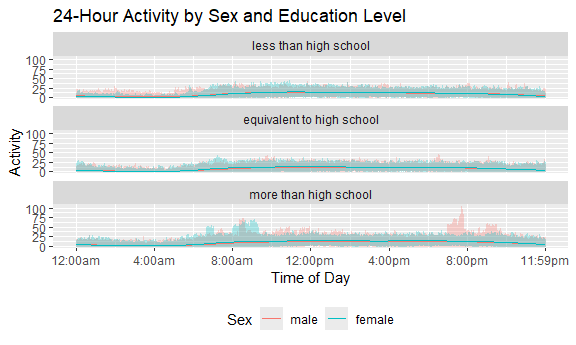

P8105_hw3
================
cmh2275
2026-10-16

# Problem 1

# Problem 2

## Import and Tidy

``` r
nhanes1_df = read_csv(file = "./nhanes_covar.csv", skip = 4, na = c("NA", "", "."))|>
    janitor::clean_names()|>
mutate(sex = factor(sex, 
                    levels = c("1","2"), 
                    labels = c("male", "female")), 
       education = factor(education, 
                          levels = c("1", "2", "3"), 
                          labels = c("less than high school", "equivalent to high school","more than high school"))
       )|>
  filter(age>=21)
```

    ## Rows: 250 Columns: 5
    ## ── Column specification ────────────────────────────────────────────────────────
    ## Delimiter: ","
    ## dbl (5): SEQN, sex, age, BMI, education
    ## 
    ## ℹ Use `spec()` to retrieve the full column specification for this data.
    ## ℹ Specify the column types or set `show_col_types = FALSE` to quiet this message.

``` r
nhanes2_df = read_csv(file = "./nhanes_accel.csv", na = c("NA", "", "."))|>
  janitor::clean_names()
```

    ## Rows: 250 Columns: 1441
    ## ── Column specification ────────────────────────────────────────────────────────
    ## Delimiter: ","
    ## dbl (1441): SEQN, min1, min2, min3, min4, min5, min6, min7, min8, min9, min1...
    ## 
    ## ℹ Use `spec()` to retrieve the full column specification for this data.
    ## ℹ Specify the column types or set `show_col_types = FALSE` to quiet this message.

## Join

``` r
fullnhanes_df = left_join(nhanes1_df, nhanes2_df)
```

    ## Joining with `by = join_by(seqn)`

## Table & Visualization of Education by Sex

``` r
fullnhanes_df |>
  count(sex,education)|>
  pivot_wider (names_from = sex, 
               values_from = n, 
               values_fill = 0
  )
```

    ## # A tibble: 3 × 3
    ##   education                  male female
    ##   <fct>                     <int>  <int>
    ## 1 less than high school        28     29
    ## 2 equivalent to high school    36     23
    ## 3 more than high school        56     59

``` r
fullnhanes_df |>
  ggplot (aes(x = age, fill = sex)) +
  geom_histogram(position = "dodge", binwidth = 2)+
facet_wrap (~education)+
  labs(
    title = "Age Distribution for Males and Females Across Education Levels", 
    x = "Age (years)", 
    y = "Count", 
    color = "Sex"
  )+
theme (legend.position = "bottom")
```

    ## Ignoring unknown labels:
    ## • colour : "Sex"


The “more than high school” education level has a larger count of
participants than the other two levels. While “more than high school”
and “less than high school” had relatively the same number of males and
females in them, the “equivalent to high school” had 13 less female
participants than male. Particpant’s ages were distributed across 20 to
80 years, with most ages having one or two participants at that age. The
“more than high school” education level had more ages that had more than
two participants than the other two education levels.

## total activity

``` r
fullnhanes_df = fullnhanes_df |>
  mutate(total_activity = rowSums(across(starts_with("min"))))
```

## Total Activity Visualization

``` r
fullnhanes_df |>
  ggplot(aes (x = age, y = total_activity, color = sex))+
  geom_point(alpha = 0.5)+
  geom_smooth(se = FALSE, method = "lm")+
  facet_wrap(~education)+
  labs(
    title = "Total Activity by Age and Sex Across Education Levels", 
    x = "Age (years)", 
    y = "Total Activity in MIMS", 
    color = "Sex"
  )+
  theme(legend.position = "bottom")
```

    ## `geom_smooth()` using formula = 'y ~ x'


Total activity demonstrates large variablity across sex and age;
however, there is a general trend across education levels to decrease
across age. This is most pronounced in the “less than high school”
level, particularly for females, while this much less pronouncced in the
“more than high school” level.

## 24-hour Activity

``` r
fullnhanes_df |>
  pivot_longer(
    cols = starts_with("min"),
    names_to = "minutes", 
    names_prefix = "min", 
    values_to = "activity"
  )|>
  mutate (minutes = as.numeric(minutes))|>
  
  ggplot(aes(x = minutes, y = activity, color= sex))+
  geom_line (aes(group = sex), alpha = 0.3)+
  geom_smooth(se = FALSE, linewidth = 0.5)+
  facet_wrap(~education, ncol = 1)+
  scale_x_continuous(
    breaks = seq(0,1440, by = 240), 
    labels = c("12:00am", "4:00am", "8:00am", "12:00pm", "4:00pm", "8:00pm", "11:59pm")
  )+
  labs (
    title = "24-Hour Activity by Sex and Education Level", 
    x = "Time of Day",
    y = "Activity", 
    color = "Sex"
  )+
  theme(legend.position = "bottom")
```

    ## `geom_smooth()` using method = 'gam' and formula = 'y ~ s(x, bs = "cs")'



From these graphs, activity begins increasing around 6-7 hours after the
start wear, which is consistent with the data starting at midnight and
thus participants are likely sleeping up until 6 or 7 in the morning and
then begin their day, leading to increased activity levels. Activity
decreases are also noted to start around 10pm, or hour 22 of wear,
consistent with common sleep cycles. There appears to be more male
activity across typical sleeping hours in the “less than high school”
education level, which could be indicative of nightshift work in this
population. There is also a pattern of high activity in males in the
“more than high school” education level that is impacting the graphs,
which might be indicative of afterwork activity with this population.

# Problem 3

``` r
jan20_df = read_csv(file = "./Jan 2020 Citi.csv") |>
  janitor::clean_names()|>
  mutate(month = c("jan"), 
         year = c("2020"),
         rideable_type = as.factor(rideable_type), 
         weekdays = as.factor(weekdays), 
         start_station_name = as.factor(start_station_name),
         end_station_name = as.factor(end_station_name), 
         member_casual = as.factor(member_casual))
```

    ## Rows: 12420 Columns: 7
    ## ── Column specification ────────────────────────────────────────────────────────
    ## Delimiter: ","
    ## chr (6): ride_id, rideable_type, weekdays, start_station_name, end_station_n...
    ## dbl (1): duration
    ## 
    ## ℹ Use `spec()` to retrieve the full column specification for this data.
    ## ℹ Specify the column types or set `show_col_types = FALSE` to quiet this message.

``` r
jan24_df = read_csv(file = "./Jan 2024 Citi.csv")|>
  janitor::clean_names()|>
   mutate(month = c("jan"), 
         year = c("2024"),
         rideable_type = as.factor(rideable_type), 
         weekdays = as.factor(weekdays), 
         start_station_name = as.factor(start_station_name),
         end_station_name = as.factor(end_station_name), 
         member_casual = as.factor(member_casual))
```

    ## Rows: 18861 Columns: 7
    ## ── Column specification ────────────────────────────────────────────────────────
    ## Delimiter: ","
    ## chr (6): ride_id, rideable_type, weekdays, start_station_name, end_station_n...
    ## dbl (1): duration
    ## 
    ## ℹ Use `spec()` to retrieve the full column specification for this data.
    ## ℹ Specify the column types or set `show_col_types = FALSE` to quiet this message.

``` r
july20_df = read_csv(file = "./July 2020 Citi.csv")|>
  janitor:: clean_names()|>
  mutate(month = c("july"), 
         year = c("2020"),
         rideable_type = as.factor(rideable_type), 
         weekdays = as.factor(weekdays), 
         start_station_name = as.factor(start_station_name),
         end_station_name = as.factor(end_station_name), 
         member_casual = as.factor(member_casual))
```

    ## Rows: 21048 Columns: 7
    ## ── Column specification ────────────────────────────────────────────────────────
    ## Delimiter: ","
    ## chr (6): ride_id, rideable_type, weekdays, start_station_name, end_station_n...
    ## dbl (1): duration
    ## 
    ## ℹ Use `spec()` to retrieve the full column specification for this data.
    ## ℹ Specify the column types or set `show_col_types = FALSE` to quiet this message.

``` r
july24_df = read_csv(file = "./July 2024 Citi.csv")|>
  janitor::clean_names()|>
   mutate(month = c("july"), 
         year = c("2024"),
         rideable_type = as.factor(rideable_type), 
         weekdays = as.factor(weekdays), 
         start_station_name = as.factor(start_station_name),
         end_station_name = as.factor(end_station_name), 
         member_casual = as.factor(member_casual))
```

    ## Rows: 47156 Columns: 7
    ## ── Column specification ────────────────────────────────────────────────────────
    ## Delimiter: ","
    ## chr (6): ride_id, rideable_type, weekdays, start_station_name, end_station_n...
    ## dbl (1): duration
    ## 
    ## ℹ Use `spec()` to retrieve the full column specification for this data.
    ## ℹ Specify the column types or set `show_col_types = FALSE` to quiet this message.

``` r
citifull_df = bind_rows(jan20_df, jan24_df, july20_df, july24_df)|>
  mutate(month = as.factor(month), 
          year = as.factor(year))
```

## Table 1

``` r
citifull_df|>
count(month, year, member_casual)|>
  pivot_wider(names_from = member_casual, values_from = n, values_fill = 0)
```

    ## # A tibble: 4 × 4
    ##   month year  casual member
    ##   <fct> <fct>  <int>  <int>
    ## 1 jan   2020     984  11436
    ## 2 jan   2024    2108  16753
    ## 3 july  2020    5637  15411
    ## 4 july  2024   10894  36262

Members had more rides across all months and years than casual riders.
The use of Citi Bike by both members and casual riders has grown since
2020.

## Table 2

``` r
citifull_df|>
  filter(year == "2024", month == "july")|>
  count(start_station_name, sort = TRUE) |>
  slice_head(n=5)|>
 knitr:: kable(col.names=c("Starting station", "number of rides"),
   caption = "Five most popular starting stations in July 2024")
```

| Starting station         | number of rides |
|:-------------------------|----------------:|
| Pier 61 at Chelsea Piers |             163 |
| University Pl & E 14 St  |             155 |
| W 21 St & 6 Ave          |             152 |
| West St & Chambers St    |             150 |
| W 31 St & 7 Ave          |             146 |

Five most popular starting stations in July 2024
